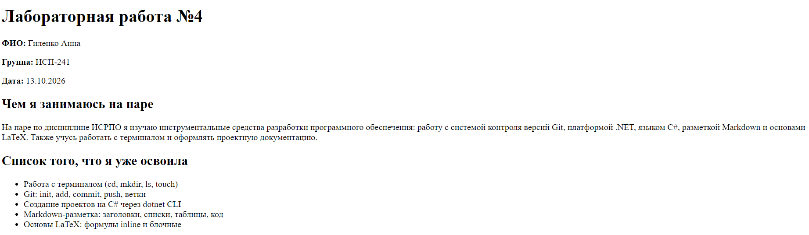
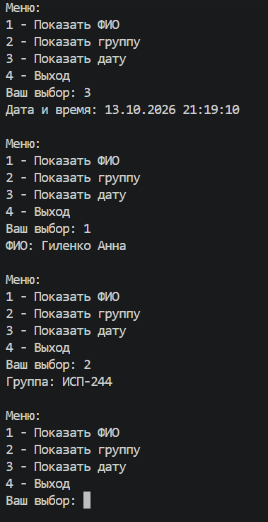
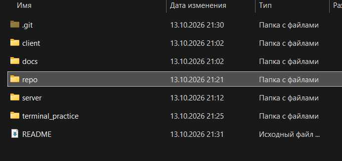
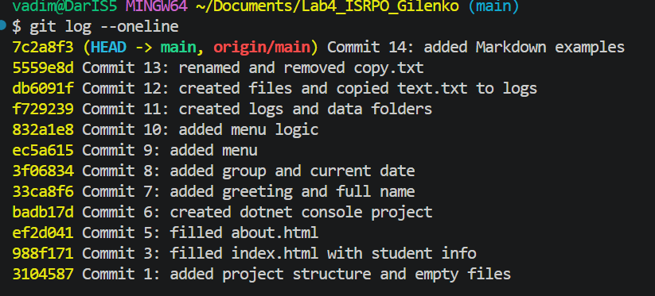

# Lab4_ISRPO_Gilenko

**ФИО:** Гиленко Анна  
**Группа:** ИСП-241
**Дата:** 13.10.2026

## Описание проекта

Лабораторная работа №4 по дисциплине ИСРПО. Проект демонстрирует навыки работы с Git, Markdown, терминалом и структурой проекта. Включает frontend (HTML), backend (C#), документацию (Markdown), примеры LaTeX и практику работы с терминалом.

## Содержание

- [Структура проекта](#структура-проекта)
- [Примеры Markdown](#примеры-markdown)
- [LaTeX](#latex)
- [Скриншоты](#скриншоты)
- [Ссылки](#ссылки)

## Структура проекта

- `client/` — frontend (HTML-страницы)
  - `index.html` — основная страница
  - `about.html` — страница «Обо мне»
- `server/` — backend (C#)
  - `Program.cs` — консольное приложение с меню
- `docs/` — документация
  - `markdown_examples.md` — примеры Markdown
  - `latex_examples.md` — примеры LaTeX
- `terminal_practice/` — практика терминала
  - `logs/` — логи
  - `data/` — данные
- `repo/` — скриншоты
- `README.md` — этот файл

## Примеры Markdown

### Заголовок

#### Подзаголовок

### Список

- Первый пункт
- Второй пункт
- Третий пункт

### Картинка



### Код

```csharp
Console.WriteLine("Hello, ISRPO!");
```

## LaTeX

Inline-формула: $E = mc^2$.

Блочная формула:

$$
\int_0^\infty e^{-x^2} dx = \frac{\sqrt{\pi}}{2}
$$

## Скриншоты








## Ссылки

- Репозиторий: [Lab4_ISRPO_Gilenko](https://gitflic.ru/project/anuta151/lab4_isrpo_gilenko)

## Заключение

В ходе лабораторной работы №4 я закрепила навыки работы с Git, терминалом, Markdown, а также с frontend и backend разработкой. Создан полноценный проект с клиентской и серверной частью, документацией и примерами разметки.